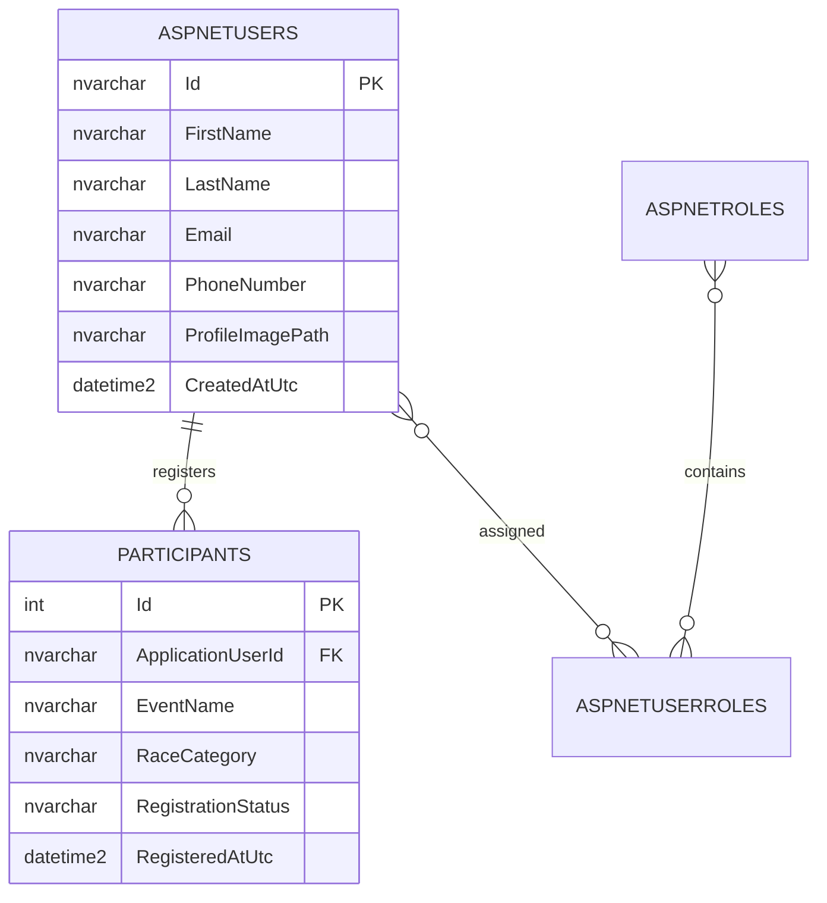

# RunWay — ASP.NET Core MVC Participant Registration

RunWay is an ASP.NET Core MVC (.NET 8) starter application for a community-run event. It includes ASP.NET Core Identity authentication, Participant/Organiser/Admin roles, participant registration, an admin dashboard, participant status management, a file-storage service, and a SQL Server/EF Core data layer.

## Requirements
- Visual Studio 2022 with the ASP.NET and web development workload
- .NET 8 SDK
- SQL Server Express, LocalDB, or SQL Server Developer Edition
- EF Core CLI (`dotnet tool install --global dotnet-ef --version 8.*`)

## 1. Configure SQL Server
Edit `appsettings.json` → `ConnectionStrings:DefaultConnection` to match your SQL Server instance. Example for SQL Server Express:

```json
"DefaultConnection": "Server=.\\SQLEXPRESS;Database=RunWayDb;Trusted_Connection=True;MultipleActiveResultSets=true;TrustServerCertificate=True"
```

The supplied default uses `(localdb)\\MSSQLLocalDB`. Use the server name shown in SQL Server Management Studio if your installation differs. Do not commit production credentials or secrets.

## 2. Create/apply the feature migration
Open a terminal in the `RunWay` folder:

```bash
dotnet restore
dotnet tool install --global dotnet-ef --version 8.*
dotnet ef migrations add RunWayParticipantFeatures
dotnet ef database update
```

The project started with an Identity-only migration. The feature migration is required because `ApplicationUser` now has `FirstName`, `LastName`, `ProfileImagePath`, and `CreatedAtUtc`, and the `Participants` table is new. The migration should be generated against the updated `ApplicationDbContext`; do not skip this step on an existing database. `Database/RunWay.sql` is a reference script for the feature schema, while EF migrations should remain the primary schema-management method.

## 3. Run the MVC application

```bash
dotnet run
```

Alternatively, open `RunWay.sln` in Visual Studio, set `RunWay` as the startup project, ensure the SQL Server instance is running, and press **F5**. The app applies pending migrations at startup and creates the `Admin`, `Participant`, and `Organiser` roles.

## 4. Configure the first administrator
Set these values using environment variables or user secrets (recommended), then start the app:

```bash
dotnet user-secrets init
dotnet user-secrets set "AdminSeed:Email" "admin@example.com"
dotnet user-secrets set "AdminSeed:Password" "Use-A-Strong-Password-123!"
```

The seed process creates the admin if it does not exist and assigns the `Admin` role. The app intentionally does not ship with a hard-coded admin password. Empty values in `appsettings.json` mean no administrator is created automatically.

## Features and routes
- `/` — RunWay home page
- `/Account/Register` — participant registration; creates an Identity user and assigns the selected `Participant` or `Organiser` role; participant registrations also create a participant record
- `/Account/Login` — sign in
- `/Organiser` — Organiser-only area
- `/Participants/MyRegistration` — signed-in participant's own registration
- `/Admin` or `/Admin/Index` — Admin-only dashboard
- `/Participants` — Admin-only participant list/search/status updates
- `/Home/AccessDenied` — access-denied page

Role restrictions are enforced on the server with `[Authorize(Roles = "Admin")]`. Hiding navigation links is not treated as a security boundary.

## File storage
`Services/FileStorageService.cs` provides validated local storage under `wwwroot/uploads/<folder>`. It permits JPG/JPEG, PNG, WEBP and PDF files up to 5 MB and uses generated filenames. The service is registered with dependency injection for use by future profile/document upload actions. Add malware scanning and non-public storage for sensitive documents before production deployment.

## ERD



## Test checklist
1. Register as Participant with valid details; verify `AspNetUsers`, `AspNetUserRoles`, and `Participants` records are created.
2. Register as Organiser; verify the Organiser role is assigned and no participant registration row is created.
3. Try duplicate email and invalid/weak passwords; registration should show validation errors.
4. Log in as a participant; verify `/Participants/MyRegistration` displays only that user's registration.
5. Attempt to open `/Admin` and `/Participants` as a participant, and `/Admin` as an Organiser; the request should be denied/redirected to access denied.
6. Configure the seed admin, restart, sign in, and verify dashboard counts and participant list.
7. Change a participant status to Confirmed or Cancelled; refresh and verify it persists.
8. Test an invalid login and repeated failures; verify an error is displayed and Identity lockout applies.
9. Test the file storage service with an allowed file, a disallowed extension, an empty file, and a file over 5 MB.
10. Stop SQL Server or use an invalid connection string; confirm startup logs a database migration failure rather than silently continuing.

## Important notes
- This package is source code; run the migration commands in your environment before first use. I could not compile or execute it in this environment because the .NET SDK is not installed here.
- For production, use HTTPS, environment/user-secret configuration, a proper email-confirmation flow, upload malware scanning, and a production-grade file store.
